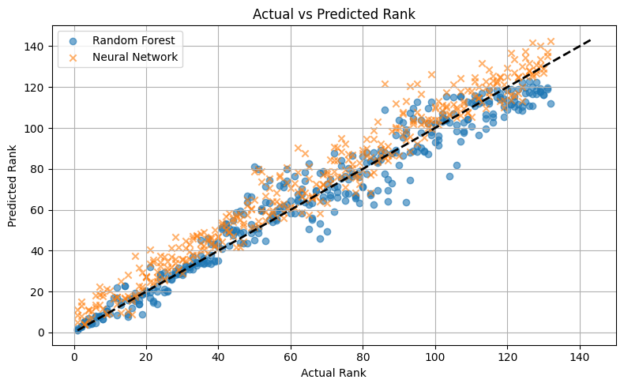

# Predicting National Innovation from Economic Indicators

A Random Forest predicts a country's Global Innovation Index (GII) rank from its economic indicators with **R² = 0.948**, and **per capita GNI** is by far the strongest predictor.

It asks to what extent a country's innovation performance, measured by the GII, can be predicted from its economic indicators, and which indicators explain the differences between countries.

This project merges the GII rankings with national economic data for 2011 to 2021 (1,562 country-year observations) and compares two models for predicting a country's GII rank: a Random Forest Regressor and a Multi-Layer Perceptron neural network.

It was my final project for **GEOG0178 Machine Learning for Social Sciences with Python** at University College London (2024-25).

The full write-up, with the literature review, method and discussion, is in **[report.pdf](report.pdf)**.

## Results

| Model | MAE | RMSE | R² |
|---|---|---|---|
| Random Forest | 6.24 | 8.53 | **0.948** |
| Neural network (MLP) | 7.64 | 9.76 | 0.932 |



- The Random Forest outperformed the neural network on every metric. Tree-based models tend to suit small and medium tabular datasets like this one, while MLPs need more data to reach their best performance and are harder to interpret.
- Feature importance points to **per capita GNI** as by far the strongest predictor of GII rank, with an importance close to 0.8. Every other indicator scored below 0.1.
- These are associations, not causal effects. Factors such as institutional quality and education were not in the data and are natural next steps, along with panel methods that capture change over time.

## Tools

      

## Notebook

[`innovation_prediction.ipynb`](innovation_prediction.ipynb) runs end to end, with outputs saved:

1. **Data cleaning and wrangling**: standardising country names to ISO alpha-3 codes (pycountry), merging the two datasets on country and year, and removing invalid ranks and incomplete rows.
2. **Exploratory data analysis**: distributions, correlations and the relationship between income and innovation rank.
3. **Modelling**: a Random Forest Regressor, and an MLP in a scikit-learn pipeline with feature scaling.
4. **Results and comparison**: MAE, RMSE and R², residual analysis and feature importances.

## Data

The two source datasets go in `data/`. See [`data/README.md`](data/README.md) for where to download them.

## Running it

```
pip install -r requirements.txt
jupyter notebook innovation_prediction.ipynb
```
